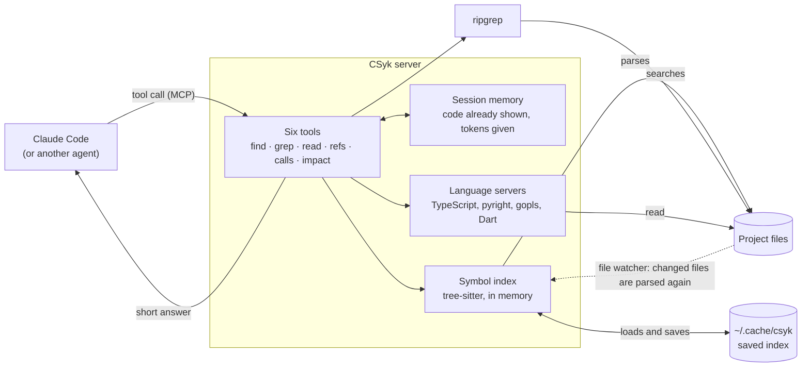
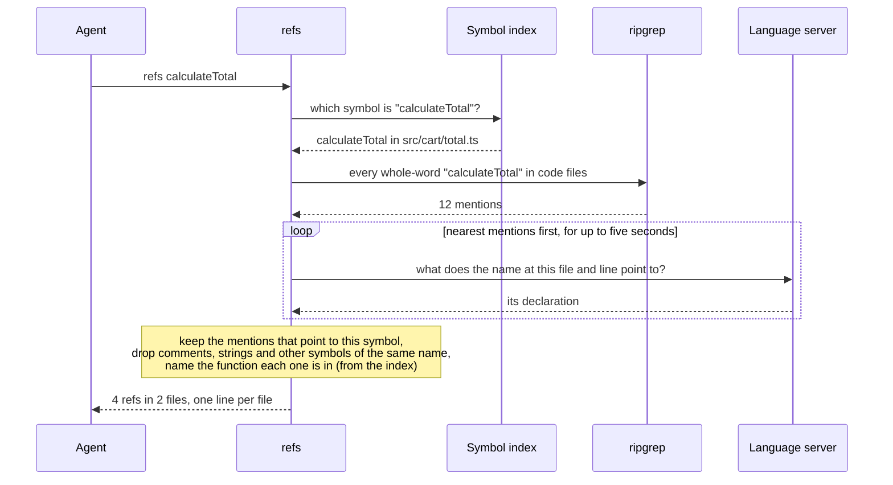
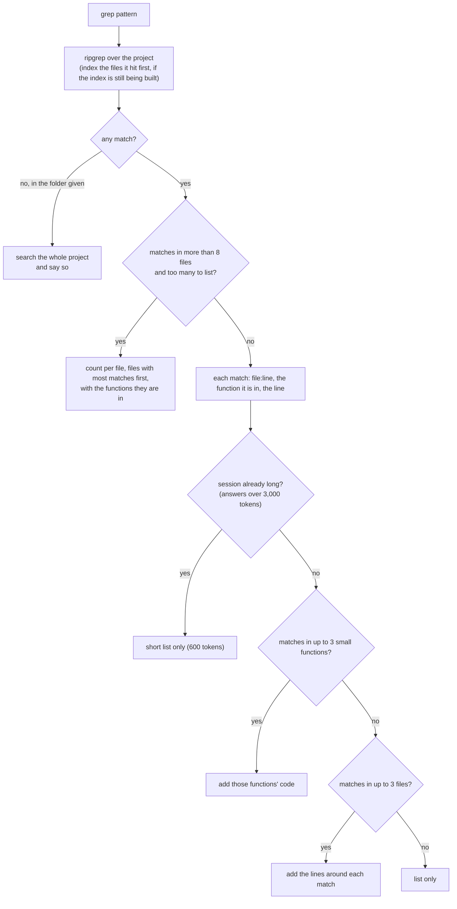

<p align="center">
  
</p>

<h1 align="center">CSyk</h1>

<p align="center"><em>He doesn't read the file. He knows the line.</em></p>

<p align="center">
  
  
  
  
</p>

Code search for AI coding agents. Your agent asks where something is defined, who uses it, who
calls it, or what an edit touches. CSyk answers in a few lines, from an index of the code and from
the language's own compiler, instead of a pile of text-search hits and whole files. It plugs
into the agent as an MCP server (Model Context Protocol, the standard way to give an agent extra
tools).

| **98.6%** | **240 tokens** | **7% fewer tokens** | **8 ms** |
|:---:|:---:|:---:|:---:|
| first answer right when looking up a definition by name (text search: 33.1%) | to answer what costs 16,899 tokens with text search and file reads | per real GitHub issue for Claude Code, over 120 issues in four languages, and faster | per answer, median |

<p align="center">
  <b><a href="#install">Install</a> · <a href="#before-and-after">Before and after</a> · <a href="#numbers">Numbers</a> · <a href="#tools">Tools</a> · <a href="#how-it-works">How it works</a> · <a href="#contributing">Contributing</a></b>
</p>

Runs on your machine: code never leaves it, and nothing is sent anywhere. macOS and Linux.

---

## Install

```sh
npm install -g csyk          # or from a clone: npm install && npm run build && npm install -g .
cd your-project
csyk setup --write           # sets up Claude Code for this project
```

That's it. Start Claude Code in the project and the six CSyk tools are there.

`csyk setup --write` writes four things:

1. `.mcp.json`: tells Claude Code to start CSyk (the same as `claude mcp add csyk -- csyk serve`).
2. `.claude/settings.json`: turns off Claude Code's own `Grep` tool, since CSyk's `grep` replaces
   it (see below).
3. A short note in `CLAUDE.md` telling the agent which CSyk tool to use when.
4. `.claude/skills/csyk/SKILL.md`: a longer guide the agent loads when it needs it.

Without `--write`, it only prints them. With `--user`, it writes them for every project (the note
goes to `~/.claude/rules/csyk.md`). Then start Claude Code in the project.

**Why turn off `Grep`.** CSyk's `grep` searches the same way (ripgrep, regular expressions, a
`path` and a `glob`), and also says which function each match is in. When an agent has both, it
uses both, and the description of `Grep` alone costs more tokens on every turn than all six CSyk
tools together. To keep `Grep`, remove `"Grep"` from `permissions.deny` in `.claude/settings.json`.

For Go, install `gopls` (`go install golang.org/x/tools/gopls@latest`); for Dart, the Dart or
Flutter SDK. TypeScript and Python support comes bundled.

Other agents that support MCP: run `csyk serve [folder]`, which talks over standard input and
output.

## Before and after

The question an agent asks all day: who uses this? Here, `restoreElements` in the excalidraw
repository.

**Text search** (`rg -n -w restoreElements`): 100 lines and 3,094 tokens, from 13 files. Imports,
tests and every other line where the name is written, for the agent to sort out:

```text
./excalidraw-app/data/firebase.ts:8:import { restoreElements } from "@excalidraw/excalidraw/data/restore";
./excalidraw-app/data/firebase.ts:222:      restoreElements(await decryptElements(prevStoredScene, roomKey), null),
./excalidraw-app/data/firebase.ts:244:    restoreElements(await decryptElements(storedScene, roomKey), null),
./excalidraw-app/data/firebase.ts:265:    restoreElements(await decryptElements(storedScene, roomKey), null, {
./packages/excalidraw/data/restore.ts:960:export const restoreElements = <T extends ExcalidrawElement>(
… 95 more lines
```

**CSyk** (`refs restoreElements`): 8 lines and 281 tokens. The uses the compiler confirms, one line
per file, with the function each one is in:

```text
packages/excalidraw/data/restore.ts#restoreElements · 75 refs in 9 files · lsp
packages/excalidraw/components/App.tsx  305, 3621·initializeScene, 4625·addElementsFromPasteOrLibrary
packages/excalidraw/data/blob.ts  26, 163·loadSceneOrLibraryFromBlob
packages/excalidraw/data/restore.ts  1390·restoreLibraryItem
packages/excalidraw/index.tsx  420
packages/excalidraw/scene/export.ts  61, 572·configExportDimension, 1325·exportToBlob, 1398·exportToClipboard
packages/excalidraw/tests/data/restore.test.ts  58, 77, 89, 97, 112, 118, 123, 128, 140, 149, 166, …
… 3 more; grep the name with a path to see them
```

Same question, a tenth of the tokens, and the agent can act on it without opening a file.

## Numbers

Two kinds of measurement, both reproducible from this repository.

**Single questions**, on twelve public repositories (three per language, small to large), against
plain text search plus reading the file:

| | Text search and file reads | **CSyk** |
|---|---|---|
| Finding a definition by its exact name: first answer right | 33.1% | **98.6%** |
| Finding a definition by part of its name: first answer right | 7.6% | **99.5%** |
| Finding uses of a symbol: share of answers that really are uses | 64.1% | **99.2%** |
| Tokens the agent reads to answer the same questions | 16,899 | **240 (98.6% fewer)** |
| Time per answer (median) | 75 ms | **8 ms** |

**Whole agent sessions** on four benchmarks of real GitHub issues: over all 120 issues, Claude
Code with CSyk used 7% fewer tokens (11% in JavaScript, 10% in Python, 8% in Go, level in
TypeScript), finished sooner per issue, and named 3.4 points more of the functions the fix changed.
Details in
[Public benchmarks](#public-benchmarks-finding-the-code-an-issue-needs-changed) and
[Results on single questions](#results-on-single-questions).

## Tools

Six tools. Their descriptions take 539 tokens, which matters because an agent re-reads them on
every turn. Every answer stays under 2,000 tokens (`grep` may add up to 1,000 more for the code
around its matches) and says what it left out and how to narrow the question.

| Tool | Question | Answer |
|---|---|---|
| `find` | Where is a symbol, by name or part of a name? | one line per symbol: where it is, what kind it is, its first line; for a short symbol with exactly that name, its code too |
| `grep` | Where does this text appear? | each match with the function or class it is in, plus the code around the matches when they are in a few files; across many files, a count per file |
| `read` | Show me this | a symbol's code (`file#Name`, `file:Name`, `Class.method` or a plain name); a short file whole; a long file or a folder as a list of its symbols; `file:120` or `file:120-160` as those lines |
| `refs` | Who uses this symbol? | every use the compiler confirms, file by file, with the function each one is in |
| `calls` | Who calls this, or what does it call? | callers (`in`) or the functions it calls (`out`), up to three levels |
| `impact` | What does my change touch? | the symbols you changed, their callers two levels up, and the test files among them |

Answers are built so the agent does not need to ask again. A `grep` that finds nothing in the
folder it was given searches the whole project and says so. A `read` of a path that does not exist
lists files with the same name. Right after starting on a large project, the first `grep` answers
in about a second while the index is still being built. Once CSyk's answers in a session pass 3,000 tokens, `grep`
and `find` stop showing code and `grep` lists less: in a long session, everything added is re-read
on every later turn.

What the agent sees, in the excalidraw repository:

```text
> find "restore elements"
2 symbols · index
packages/excalidraw/data/restore.ts#restoreElements  function 960  restoreElements = <T extends ExcalidrawElement>(
packages/excalidraw/components/App.tsx#App.restoreReadyToEraseElements  method 10301  private restoreReadyToEraseElements = () => {

> refs restoreElements
packages/excalidraw/data/restore.ts#restoreElements · 75 refs in 9 files · lsp
packages/excalidraw/components/App.tsx  305, 3621·initializeScene, 4625·addElementsFromPasteOrLibrary
packages/excalidraw/data/blob.ts  26, 163·loadSceneOrLibraryFromBlob
packages/excalidraw/scene/export.ts  61, 572·configExportDimension, 1325·exportToBlob, 1398·exportToClipboard
…

> calls getSceneVersion
calls in · packages/element/src/index.ts#getSceneVersion · 7 callers · lsp
excalidraw-app/collab/Collab.tsx#Collab.initializeRoom  752
excalidraw-app/collab/Collab.tsx#Collab.broadcastElements  973, 977
excalidraw-app/data/firebase.ts#isSavedToFirebase  135
…
```

The last word of each first line says where the answer came from: `index` (CSyk's own index of
the code), `lsp` (the language's compiler, through its language server) or `text` (plain text,
when no language server is installed).

If the agent asks again for code it has already seen and that has not changed, CSyk answers
`[unchanged: <id>, shown at call #n]` instead of sending it again.

## How it works

CSyk is one process per project. Claude Code starts it and talks to it over standard input and
output (MCP). Inside, every answer comes from three sources: an index of the code that CSyk keeps
itself, ripgrep for plain text, and the language's own compiler, run as a language server.



**One question, step by step.** `refs` (who uses this symbol?) shows how the three sources work
together: the index finds the symbol, ripgrep finds every place its name is written, and the
compiler says which of those places really mean it.



**What `grep` sends back.** Most of an agent's tokens are its context, re-read on every turn, so
`grep` tries to answer in a way that saves the agent its next turn without filling its context:



**Where things are in the code.**

| Part | File | What it does |
|---|---|---|
| Command line | `src/cli.ts` | `csyk serve`, `csyk setup`, `csyk hook` |
| Server | `src/server/server.ts` | registers the six tools with MCP, counts what each answer costs |
| Tool routing | `src/tools/dispatch.ts` | the tools' descriptions and arguments, checks them, picks the tool |
| Tools | `src/tools/tools.ts`, `src/tools/calls.ts` | `find`, `grep`, `read`, `refs`; `calls` and `impact` |
| Index | `src/index/symbol-index.ts`, `src/index/parse.ts`, `src/index/extract/*.ts` | parsing with tree-sitter, one extractor per language, name search |
| Compiler | `src/precision/lsp-service.ts`, `src/precision/lsp-client.ts` | starting language servers, resolving each mention |
| Project | `src/workspace/workspace.ts` | the index, the file watcher, starting and stopping servers |
| Answer size | `src/token/budget.ts`, `src/token/session.ts` | cutting answers to a token budget, remembering what was shown |
| Hooks | `src/hooks/hooks.ts` | the optional Claude Code hooks |
| Agent guide | `src/guide.ts` | the note and the skill `csyk setup` writes |

**Index.** On start, CSyk parses every source file with tree-sitter (a fast parser, about 1 ms per
file) and keeps the symbols in memory: functions, classes, methods, fields, constants, types and
enum members, with their line ranges and signatures. React components, NestJS routes, Flutter
widgets and similar are marked as such. The index is saved in `~/.cache/csyk`, so the next start
only parses files that changed. While running, CSyk watches the files: each tool call first takes
in any edits, so answers are never out of date.

**Names.** `find` ranks exact matches first, then joined words (`token store` finds `TokenStore`),
then names that start with or contain the query. Tests and private helpers come lower. When
nothing matches, it suggests the three closest names.

**Uses.** A language server's own "find references" only looks inside one project, so uses in
other packages of the same repository go missing. CSyk instead finds every mention of the name as
a whole word, asks the language server what each mention points to, and keeps the ones that point
to the symbol. This works across packages, tells apart different symbols with the same name, and
skips comments and strings.

**Calls and impact.** Callers are uses that call the symbol (or construct it, decorate with it,
render it, or pass it as a callback), grouped by the function they are in. For a method, calls
through an interface or base class count too, since they can reach it. The functions a symbol
calls are the calls in its body, each followed to its definition. `impact` reads `git diff`, finds
the symbols the change touches and follows their callers two levels up, stopping at tests and at
symbols with more than 40 callers.

**Speed.** Answers are cached until a file changes. A search for uses looks at the nearest
mentions first and stops after five seconds (six for `calls` and `impact`); when it stops early,
the answer says how much it covered. Language servers start when first needed and stop after ten
minutes without use.

## Languages and frameworks

| Language | Index | Uses, definitions, calls | Recognised framework parts |
|---|---|---|---|
| TypeScript, JavaScript | tree-sitter | TypeScript 7 compiler (bundled) | React components and hooks, NestJS routes and providers |
| Python | tree-sitter | pyright (bundled) | FastAPI routes |
| Go | tree-sitter | `gopls` | |
| Dart | tree-sitter (Dart 3.13 grammar) | the Dart analysis server | Flutter widgets |

Install the project's dependencies (`npm install`, `go mod download`, `flutter pub get`) so the
compilers can follow imports into them. CSyk's answers only point inside the project either way.

## Hooks

Hooks are small programs Claude Code runs before or after a tool call. `csyk setup` adds one:

- `session-reset`: when a session starts or its context is compacted, tells CSyk to send code
  again that it had already shown.

`csyk setup --hooks` adds two more, which refuse certain calls and point the agent to CSyk
instead. They are off by default: each refused call costs the agent a turn, and on the public
benchmarks below the agent used fewer tokens without them.

- `pre-read`: refuses reading a whole source file over 400 lines and suggests `read` with the
  file's path. Reading part of a file is always allowed.
- `pre-grep`: refuses a text search for a single identifier and suggests `find` and `refs`.
  Phrases, regular expressions and searches outside the project are allowed.

Each hook only acts while CSyk serves the folder, lets the call through if anything goes wrong,
and answers in about 80 ms.

## Results on single questions

Twelve public repositories, each pinned to one commit. The test questions are generated from each
language's own compiler, which also gives the right answers. There are 30 questions of each kind
per repository, fewer when a small repository has fewer.

The six kinds of question:

- **Exact name**: find the definition of a name. Scored by whether the first answer is right.
- **Part of a name**: find a definition from a few words of its name (`calc total` for
  `calculateTotal`). Scored by whether the first answer is right.
- **Uses**: find every use of a symbol. "Found" is the share of real uses in the answer; "correct"
  is the share of the answer that really are uses.
- **Callers and calls**: find who calls a function, or what it calls. Found and correct as above.
- **Message**: given an error message or other text from the code, find the function it is in,
  among the first five answers.
- **Edit impact**: after an edit to one or two functions, list those functions and their callers
  two levels up. Found and correct as above.

| Repository | Exact name | Part of a name | Uses: found / correct | Callers and calls: found / correct | Message | Edit impact: found / correct |
|---|---|---|---|---|---|---|
| zustand (TypeScript, small) | 100% | 100% | 100% / 100% | 100% / 87% | 100% | 96.7% / 91.8% |
| excalidraw (TypeScript, medium) | 100% | 100% | 100% / 100% | 100% / 85.3% | 100% | 98.3% / 96.8% |
| nest (TypeScript, large) | 100% | 100% | 99.2% / 100% | 96.7% / 84.1% | 100% | 95.8% / 96.9% |
| provider (Dart, small) | 100% | 100% | 100% / 100% | 100% / 93.2% | 100% | 70.9% / 89.2% |
| wonderous (Dart, medium) | 100% | 100% | 100% / 100% | 100% / 99.2% | 100% | 100% / 98.2% |
| flame (Dart, large) | 96.7% | 100% | 100% / 100% | 97.9% / 100% | 100% | 71.4% / 80.9% |
| fastapi-template (Python, small) | 100% | 100% | 100% / 100% | 100% / 100% | 100% | 100% / 91.5% |
| dispatch (Python, medium) | 100% | 100% | 100% / 100% | 100% / 92.7% | 100% | 98.8% / 83.7% |
| django (Python, large) | 96.7% | 100% | 96.7% / 96.7% | 100% / 92.7% | 100% | 99.3% / 47.2% |
| chi (Go, small) | 100% | 100% | 100% / 100% | 100% / 100% | 100% | 97.8% / 98.7% |
| pocketbase (Go, medium) | 100% | 96.7% | 100% / 100% | 96.7% / 96% | 100% | 94.9% / 93.4% |
| prometheus (Go, large) | 90% | 96.7% | 93.3% / 93.3% | 93.3% / 91.9% | 100% | 89.3% / 97.2% |

The comparison with text search for every repository, and the time each tool takes, are in
[docs/BASELINES.md](docs/BASELINES.md).

## Public benchmarks: finding the code an issue needs changed

Answering single questions well is one thing; what matters in the end is whether an agent finds
the right code with fewer tokens and in less time. These benchmarks check that on real GitHub
issues. Claude Code (with the Claude Sonnet model, run from the command line without its
interface) gets the text of an issue and the repository as it was just before the fix, and must
name the files and functions that need to change, without editing anything. Its answer is
compared with the fix that was actually merged:

- **First file right**: the first file it names is one the fix changed.
- **All changed files in first five**: every file the fix changed is among the first five it names.
- **Changed functions named**: the share of the functions and methods the fix changed that it
  names.
- **Median time**: time per issue, from start to answer; the median, from the round where both
  setups ran at the same moment.
- **Tokens per issue**: everything the model read and wrote in the session, including the context
  it re-reads on every turn; the mean and the median over the 30 issues.

Two setups answer the same issues. **Claude Code alone** has its own `Read`, `Grep` and `Glob`.
**With CSyk** is Claude Code as `csyk setup` leaves it: CSyk's six tools in place of `Grep`, plus
`Read` and `Glob`, the note and the skill.

Each benchmark contributes 30 issues drawn at random from the whole dataset (a fixed seed, no
filter on difficulty). Each setup ran the same 30 issues several times, and the table shows the
average of those runs: two runs of the same setup can differ by several points. The model's
response time changes over the day, so times come from the two rounds where both setups ran at the
same moment. Measured on 2026-10-29; the CSyk runs are its last two versions, which differ only in
`grep` listing every match when they all fit. The 1,170 sessions in the table cost about $57.

| Benchmark | Language | Setup | Runs | First file right | All changed files in first five | Changed functions named | Median time, run side by side | Tokens per issue, mean | Tokens per issue, median | Issues where CSyk used fewer tokens |
|---|---|---|---|---|---|---|---|---|---|---|
| [SWE-PolyBench Verified](https://github.com/amazon-science/SWE-PolyBench) (Amazon) | TypeScript | Claude Code alone | 6 | 93.9% | 45.6% | 55.7% | 15.3 s | 69,740 | 57,950 | |
| | | with CSyk | 5 | 90.7% | 42.0% | 63.5% | 14.1 s | 69,604 (−0%) | 56,977 (−2%) | 22 of 30 |
|  | JavaScript | Claude Code alone | 5 | 84.0% | 50.0% | 57.5% | 20.2 s | 82,770 | 74,647 | |
| | | with CSyk | 4 | 85.0% | 48.3% | 57.2% | 15.5 s | 73,872 (−11%) | 64,867 (−13%) | 20 of 30 |
| [SWE-bench Verified](https://www.swebench.com) (Princeton, OpenAI) | Python | Claude Code alone | 6 | 92.8% | 85.0% | 66.6% | 11.9 s | 47,390 | 45,580 | |
| | | with CSyk | 4 | 90.8% | 86.7% | 68.0% | 10.4 s | 42,747 (−10%) | 35,488 (−22%) | 24 of 30 |
| [Multi-SWE-bench mini](https://huggingface.co/datasets/ByteDance-Seed/Multi-SWE-bench_mini) (ByteDance) | Go | Claude Code alone | 5 | 91.3% | 60.7% | 64.7% | 14.6 s | 60,814 | 55,022 | |
| | | with CSyk | 4 | 90.0% | 60.0% | 70.0% | 13.8 s | 56,004 (−8%) | 52,882 (−4%) | 21 of 30 |

Over all 120 issues, comparing each issue's average with and without CSyk (with a 95% confidence
interval from resampling the issues):

| | With CSyk, against Claude Code alone | 95% interval |
|---|---|---|
| Tokens per issue | **7.1% fewer** | 3.0% to 11.2% fewer |
| Changed functions named | **3.4 points more** | 0.9 to 6.1 points more |
| First file right | 1.4 points fewer | 3.3 fewer to 0.4 more |
| All changed files in first five | 1.1 points fewer | 3.0 fewer to 0.8 more |

What this shows:

- **Fewer tokens.** 8% to 11% fewer per issue in JavaScript, Python and Go (22% fewer on the median
  Python issue), level in TypeScript; fewer on 20 to 24 of each benchmark's 30 issues.
- **Sooner.** 0.8 to 4.7 seconds less per issue at the median, with both setups running at the
  same time.
- **More of the right functions, about the same files.** The agent names more of the functions the
  fix changed (7.8 points more in TypeScript, 5.3 in Go, 1.4 in Python, level in JavaScript). On
  files it may be slightly behind: one to two points fewer, less than one issue in 30, and within
  what separates two runs of the same setup.
- **TypeScript saves least.** Three of its issues are in VS Code, a very large repository where the
  agent sometimes searches for 10 to 30 turns. Every answer added in such a session is re-read on
  every later turn, so once a session's CSyk answers pass 3,000 tokens, CSyk keeps them short.
  Before that, those sessions made TypeScript's average 9% higher than Claude Code alone; now it
  is level.
- **Why the savings are not larger.** About 96% of an agent's tokens on these issues are Claude
  Code's own context (its instructions, the tool list, the conversation), re-read on every turn;
  what the search tools return is 1.4% to 2.4%. A tool saves tokens by saving turns, not by giving
  shorter answers. CSyk's `grep` names the function around each match and shows the code around
  matches in a few files, so the agent goes back to read the place far less often: after 43% of
  searches that showed no code, and after 19% of those that showed up to 1,000 tokens of it. Longer
  tasks, with more searching, leave more to save; these benchmarks are short (two to five turns).

To reproduce:
`npm run loc -- --dataset <polybench|swebench|multiswebench> --language <name> --setup <b0|csyk-lean> --count 30 --seed 1`,
where `b0` is Claude Code alone and `csyk-lean` is with CSyk, then `npm run loc:report`. Each run
writes its results to a file in `eval/results/` named after the setup, dataset and language;
`--run <name>` keeps repeats of the same setup apart. Set `CSYK_LOC_DIR` to give a run its own
copies of the repositories, so two setups can run at the same time. Where a dataset does not list the changed functions (SWE-bench,
Multi-SWE-bench), each changed line of the fix is mapped to the function around it. Dart has no
public benchmark of this kind; its numbers are the single-question ones above.

## Limitations

- A name imported under another name (`import { a as b }`, or a default import with a different
  name) is not followed.
- Dart's compiler counts hidden `super(...)` constructor calls and calls through Flutter's base
  classes (`State`, `Diagnosticable`) as calls; CSyk does not, which is most of the gap on provider
  and flame for edit impact.
- pyright misses some calls through module aliases that CSyk finds, so CSyk's "correct" score
  against pyright on Python callers and edit impact is lower than it really is.
- A Go function declared twice under different build tags resolves to the one `gopls` builds by
  default.
- A name used thousands of times (Django's `Model.save`) gets a partial answer after the time
  limit, and the answer says so.
- In very large repositories, long search sessions save little: TypeScript, with three VS Code
  issues, is level on tokens on average.

## Contributing

Start with [How it works](#how-it-works): the diagrams and the table of files say where each part
lives. Then:

```sh
npm install
npm run typecheck
npm test
npm run build                       # JavaScript into dist/, for the npm package
node src/cli.ts serve <folder>      # run from source (Node removes the types itself)
```

The design, its phases and the decisions behind it are in [docs/PLAN.md](docs/PLAN.md).

Every change to what an agent sees (a tool, its description, an answer's shape) should be measured
on the public benchmarks before it is merged: smaller answers do not always mean fewer tokens for a
whole session, and the numbers have surprised us more than once.

### Evaluation

```sh
npm install
npm run corpora                              # fetch the twelve pinned repositories into eval/corpora/
npm test                                     # unit tests
npm run eval -- --adapter csyk --corpus excalidraw
npm run eval -- --adapter b0                 # every question through text search and file reads
npm run generate -- --corpus <name> --lang <ts|py|go|dart> --category <A|B|C|D|E|G>
```

In the commands and result files, the kinds of question are letters: A exact name, B part of a
name, C uses, D callers and calls, E message, G edit impact. `b0` is text search with file
reads.

- **Repositories** are listed in `eval/corpora.yaml` (`path`, `commit`, `git`); a
  question file refuses to run against any other commit. Run `go mod download` in the Go
  repositories and `flutter pub get` in the Dart ones (`packages/*` for provider) so their
  compilers can follow imports. Private repositories go in `eval/corpora.local.yaml` and their
  questions in `eval/cases/private/`; both are ignored by git.
- **Questions** live in `eval/cases/<repository>.<letter>.yaml`: an `id`, a `query`, the expected
  locations (`file`, optional `lines`) and, for callers and calls, a `direction`.
  `npm run generate` writes them from the language's own compiler. Check generated questions
  before trusting them.
- **Text search and file reads** (`eval/adapters/b0-ripgrep.ts`) stands for an agent with only
  built-in tools: it searches with ripgrep and reads the first matching file whole; for uses and
  callers, the matching lines are its answer.
- **Scores** go to `eval/results/`, which git ignores. Tokens are counted with OpenAI's
  `o200k_base` tokenizer as a stand-in for Claude's.
- **Agent tasks**: `npm run agent:tasks -- --corpus <name>` builds 20 tasks from a repository's
  questions, and `npm run agent -- --setup <b0|csyk> --corpus <name>` runs them through Claude
  Code without its interface (`claude -p`, billed to your account), recording tokens, tool calls,
  time, cost and passes.
- **Public benchmarks**: see the command at the end of
  [Public benchmarks](#public-benchmarks-finding-the-code-an-issue-needs-changed).

## Licence

Apache-2.0. See [LICENSE](LICENSE) and [NOTICE](NOTICE). The Dart grammar is built from
tree-sitter-dart (MIT licence); see [grammars/README.md](grammars/README.md).
