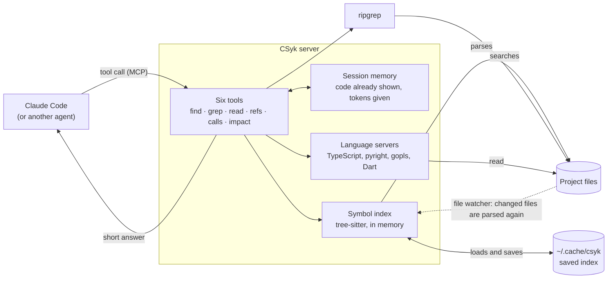
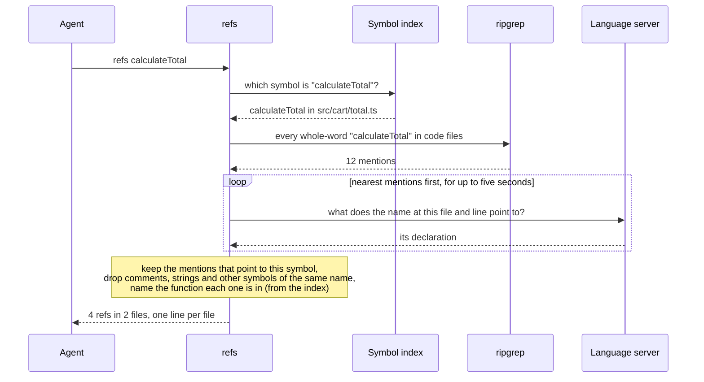
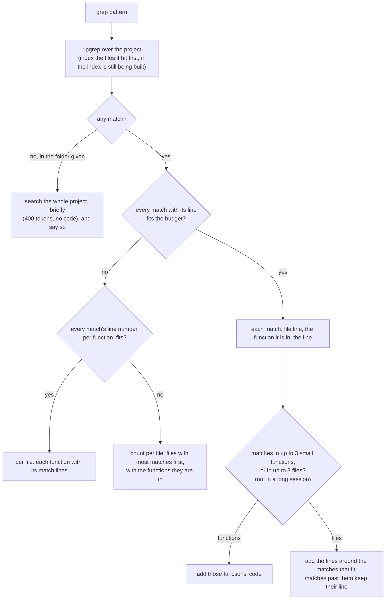

# How it works

CSyk is one process per project. Claude Code starts it and talks to it over standard input and
output (MCP). Inside, every answer comes from three sources: an index of the code that CSyk keeps
itself, ripgrep for plain text, and the language's own compiler, run as a language server.



**One question, step by step.** `refs` (who uses this symbol?) shows how the three sources work
together: the index finds the symbol, ripgrep finds every place its name is written, and the
compiler says which of those places really mean it.



**What `grep` sends back.** Most of an agent's tokens are its context, re-read on every turn, so
`grep` tries to answer in a way that saves the agent its next turn without filling its context. It
gives the most complete answer that fits its budget (2,000 tokens, 600 once the session is long),
and never a list cut short, which hides the files past it, so the agent searches again for them.
Only the count per file, the last resort, can leave files out: the ones with fewest matches.



**Where things are in the code.**

| Part | File | What it does |
|---|---|---|
| Command line | `src/cli.ts` | `csyk serve`, `csyk setup`, `csyk hook` |
| Server | `src/server/server.ts` | registers the six tools with MCP, counts what each answer costs |
| Tool routing | `src/tools/dispatch.ts` | the tools' descriptions and arguments, checks them, picks the tool |
| Tools | `src/tools/tools.ts`, `src/tools/calls.ts` | `find`, `grep`, `read`, `refs`; `calls` and `impact` |
| Index | `src/index/symbol-index.ts`, `src/index/parse.ts`, `src/index/extract/*.ts` | parsing with tree-sitter, one extractor per language, name search |
| Compiler | `src/precision/lsp-service.ts`, `src/precision/lsp-client.ts` | starting language servers, resolving each mention |
| Project | `src/workspace/workspace.ts` | the index, the file watcher, starting and stopping servers |
| Answer size | `src/token/budget.ts`, `src/token/session.ts` | cutting answers to a token budget, remembering what was shown |
| Hooks | `src/hooks/hooks.ts` | the optional Claude Code hooks |
| Agent guide | `src/guide.ts` | the note and the skill `csyk setup` writes |

**Index.** On start, CSyk parses every source file with tree-sitter (a fast parser, about 1 ms per
file) and keeps the symbols in memory: functions, classes, methods, fields, constants, types and
enum members, with their line ranges and signatures. React components, NestJS routes, Flutter
widgets and similar are marked as such. The index is saved in `~/.cache/csyk`, so the next start
only parses files that changed. While running, CSyk watches the files: each tool call first takes
in any edits, so answers are never out of date.

**Names.** `find` ranks exact matches first, then joined words (`token store` finds `TokenStore`),
then names that start with or contain the query. Tests and private helpers come lower. When
nothing matches, it suggests the three closest names.

**Uses.** A language server's own "find references" only looks inside one project, so uses in
other packages of the same repository go missing. CSyk instead finds every mention of the name as
a whole word, asks the language server what each mention points to, and keeps the ones that point
to the symbol. This works across packages, tells apart different symbols with the same name, and
skips comments and strings.

**Calls and impact.** Callers are uses that call the symbol (or construct it, decorate with it,
render it, or pass it as a callback), grouped by the function they are in. For a method, calls
through an interface or base class count too, since they can reach it. The functions a symbol
calls are the calls in its body, each followed to its definition. `impact` reads `git diff`, finds
the symbols the change touches and follows their callers two levels up, stopping at tests and at
symbols with more than 40 callers.

**Speed.** Answers are cached until a file changes. A search for uses looks at the nearest
mentions first and stops after five seconds, thirty for `calls` and `impact`, which follow callers
two levels up and may wait for a language server still loading a large project; when it stops
early, the answer says how much it covered. Language servers start when first needed and stop
after ten minutes without use.

## Answers

Answers are built so the agent does not need to ask again. A `grep` that finds nothing in the
folder it was given searches the whole project and says so. A `read` of a path that does not exist
lists files with the same name. Right after starting on a large project, the first `grep` answers
in about a second while the index is still being built. Once CSyk's answers in a session pass 3,000 tokens, `grep`
and `find` stop showing code and `grep` lists less: in a long session, everything added is re-read
on every later turn.

What the agent sees, in the excalidraw repository:

```text
> find "restore elements"
2 symbols · index
packages/excalidraw/data/restore.ts#restoreElements  function 960  restoreElements = <T extends ExcalidrawElement>(
packages/excalidraw/components/App.tsx#App.restoreReadyToEraseElements  method 10301  private restoreReadyToEraseElements = () => {

> refs restoreElements
packages/excalidraw/data/restore.ts#restoreElements · 75 refs in 9 files · lsp
packages/excalidraw/components/App.tsx  305, 3621·initializeScene, 4625·addElementsFromPasteOrLibrary
packages/excalidraw/data/blob.ts  26, 163·loadSceneOrLibraryFromBlob
packages/excalidraw/scene/export.ts  61, 572·configExportDimension, 1325·exportToBlob, 1398·exportToClipboard
…

> calls getSceneVersion
calls in · packages/element/src/index.ts#getSceneVersion · 7 callers · lsp
excalidraw-app/collab/Collab.tsx#Collab.initializeRoom  752
excalidraw-app/collab/Collab.tsx#Collab.broadcastElements  973, 977
excalidraw-app/data/firebase.ts#isSavedToFirebase  135
…
```

The last word of each first line says where the answer came from: `index` (CSyk's own index of
the code), `lsp` (the language's compiler, through its language server) or `text` (plain text,
when no language server is installed).

If the agent asks again for code it has already seen and that has not changed, CSyk answers
`[unchanged: <id>, shown at call #n]` instead of sending it again.

## Limitations

- A name imported under another name (`import { a as b }`, or a default import with a different
  name) is not followed.
- Dart's compiler counts hidden `super(...)` constructor calls and calls through Flutter's base
  classes (`State`, `Diagnosticable`) as calls; CSyk does not, which is most of the gap on provider
  and flame for edit impact.
- pyright misses some calls through module aliases that CSyk finds, so CSyk's "correct" score
  against pyright on Python callers and edit impact is lower than it really is.
- A Go function declared twice under different build tags resolves to the one `gopls` builds by
  default.
- A name used thousands of times (Django's `Model.save`) gets a partial answer after the time
  limit, and the answer says so.
- In very large repositories, long search sessions save little: TypeScript, with three VS Code
  issues, is level on tokens on average.

## Ideas for later

Ideas, not promises: each one lands only if the evaluation shows it helps.

- **Questions by meaning.** Find code from what it does rather than its name ("where are tokens
  refreshed"), with static code embeddings ranked together with names. Only if name and text
  search measurably fall short.
- **Renamed imports.** Follow `import { a as b }` and default imports under another name.
- **Long sessions in very large repositories.** Keep answers short enough that a search of 20
  turns and more costs clearly fewer tokens with CSyk than without it.
- **Lighter language servers.** On Prometheus, `gopls` is 85 of CSyk's 90 CPU seconds and 2.2 GB
  of its memory, nearly all of it type-checking the 256 modules the project depends on. Running it
  as a shared daemon (`gopls -remote=auto`) was measured and does not help on its own: a second
  CSyk still waited 5.3 seconds for its first answer, and the daemon kept 1.2 to 1.8 GB after CSyk
  stopped. It saves memory only when the editor runs `gopls` the same way, so it would be an
  option, not the default.
- **Windows.** Support and CI on Windows, after macOS and Linux.
